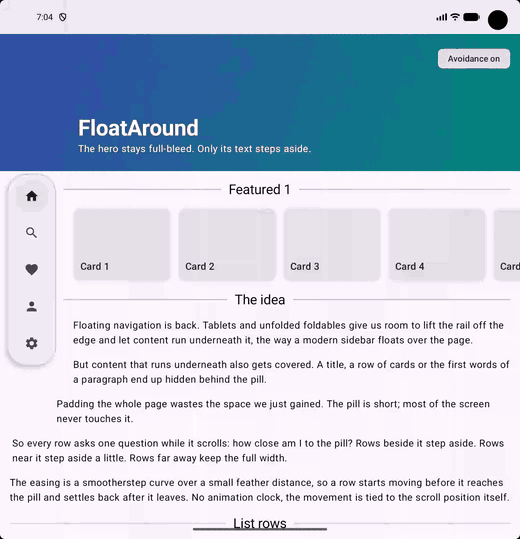

# FloatAround

Content that steps around a floating overlay, row by row, as you scroll. For Jetpack Compose and Flutter.



A floating navigation pill on a tablet or unfolded foldable covers whatever scrolls underneath it. Padding the whole page wastes the space the pill was meant to free, because the pill is short and most rows never touch it. FloatAround gives every element its own exclusion zone instead:

- elements beside the pill step aside fully (overlap plus a gap),
- elements within a feather distance step aside partially, eased with smootherstep,
- elements further away keep the full width,
- there is no animation clock: the inset is a pure function of position, so it moves with the finger and settles the moment scrolling stops.

## Install

```kotlin
// settings.gradle.kts
dependencyResolutionManagement {
    repositories {
        maven("https://jitpack.io")
    }
}

// build.gradle.kts
dependencies {
    implementation("com.github.moatazhamada:FloatAround:0.1.0")
}
```

## Use

```kotlin
val obstacle = remember { FloatingObstacle(gap = 12.dp, feather = 140.dp) }

Box(Modifier.fillMaxSize()) {
    LazyColumn {
        item { Hero() }                                              // full-bleed, runs under the pill
        item { Text(title, Modifier.avoid(obstacle)) }                // steps aside
        item {
            Row {
                HorizontalDivider(Modifier.weight(1f).avoid(obstacle)) // only the leading line shortens
                Text("Section")
                HorizontalDivider(Modifier.weight(1f))
            }
        }
        item {
            val tracker = rememberAvoidanceTracker(obstacle)
            LazyRow(
                modifier = Modifier.track(tracker),                   // frame stays full width,
                contentPadding = PaddingValues(16.dp)                 // the first card steps aside
                    .plusAvoidance(tracker, LocalDensity.current),
            ) { /* cards */ }
        }
    }
    MyFloatingPill(Modifier.align(Alignment.CenterStart).floatingObstacle(obstacle))
}
```

| API | Purpose |
| --- | --- |
| `Modifier.floatingObstacle(obstacle)` | the overlay publishes its bounds |
| `Modifier.avoid(obstacle)` | an element gives up its start edge; its end edge stays put |
| `rememberAvoidanceTracker` + `Modifier.track` + `PaddingValues.plusAvoidance` | a carousel shifts its content padding instead of its frame |
| `startInset(row, obstacle, gap, feather, rtl)` | the pure function behind all of it, for porting to other toolkits |
| `obstacle.enabled` | switch avoidance off, e.g. for before/after comparisons |

The inset is read during measure, so scrolling re-lays out only the affected elements and nothing recomposes. Right-to-left layouts are supported with the overlay on the right edge.

## Flutter

The same idea as a Flutter package lives in [`flutter/float_around`](flutter/float_around).

```dart
final obstacle = FloatingObstacle(gap: 12, feather: 140);

Stack(children: [
  ListView(children: [
    Hero(),                                                    // full-bleed
    Avoid(obstacle: obstacle, child: Text(paragraph)),          // steps aside
    Row(children: [
      Expanded(child: Avoid(obstacle: obstacle, child: Divider())), // only the leading line shortens
      Text('Section'),
      Expanded(child: Divider()),
    ]),
    AvoidanceBuilder(                                           // carousel shifts its padding
      obstacle: obstacle,
      builder: (context, insets) => ListView(
        scrollDirection: Axis.horizontal,
        padding: EdgeInsets.fromLTRB(16 + insets.left, 0, 16 + insets.right, 0),
        children: cards,
      ),
    ),
  ]),
  Align(
    alignment: AlignmentDirectional.centerStart,
    child: FloatingObstacleRegion(obstacle: obstacle, child: MyPill()),
  ),
]);
```

The Flutter package also lets the pill float on either edge (it pads whichever side the pill is on), and its example follows iOS placement: on iPhone Duo the pill sits in the camera column below the status area. Run it with `cd flutter/float_around/example && flutter run`.

## The idea in one function

```
intrusion = obstacle.right + gap - row.left          // mirrored for RTL
if intrusion <= 0               -> 0                 // already clear
d = vertical distance between row and obstacle      // 0 when they overlap
if d == 0                       -> intrusion
if d >= feather                 -> 0
t = 1 - d / feather
-> intrusion * t³(6t² - 15t + 10)                   // smootherstep
```

Because it is just geometry, it ports to any toolkit that can read an element's position after layout: SwiftUI, Flutter, the web.

## Sample

`./gradlew :sample:installDebug` on a tablet or unfolded foldable (600dp and wider shows the pill; narrower shows a bottom bar). The "Avoidance on/off" chip in the header compares both behaviours.

## Tests

`./gradlew :floataround:testDebugUnitTest` and `cd flutter/float_around && flutter test`

## License

Apache 2.0
