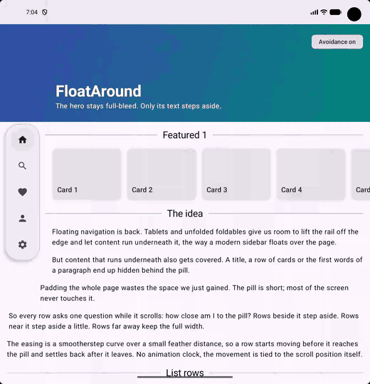

# float_around

Content that steps around a floating overlay, row by row, as you scroll.

A floating navigation pill on a tablet or unfolded foldable covers whatever scrolls underneath it. Padding the whole page wastes the space the pill was meant to free. `float_around` gives every widget its own exclusion zone: widgets beside the pill step aside fully, widgets within a feather distance step aside partially (smootherstep), widgets further away keep the full width.



## Usage

```dart
final obstacle = FloatingObstacle(gap: 12, feather: 140);

// The pill publishes its bounds
FloatingObstacleRegion(obstacle: obstacle, child: MyPill());

// Anything that should step aside
Avoid(obstacle: obstacle, child: Text(paragraph));

// Containers that should shift their padding instead of their frame
AvoidanceBuilder(
  obstacle: obstacle,
  builder: (context, inset) => ListView(
    scrollDirection: Axis.horizontal,
    padding: EdgeInsetsDirectional.only(start: 16 + inset),
    children: cards,
  ),
);
```

`obstacle.enabled = false` switches avoidance off. Right-to-left layouts are supported with the overlay on the right edge.

`startInset(row, obstacle, gap:, feather:, rtl:)` is the pure function behind it, if you want to apply the inset yourself.

The same idea for Jetpack Compose, plus an idea paper, lives at https://github.com/moatazhamada/FloatAround.
